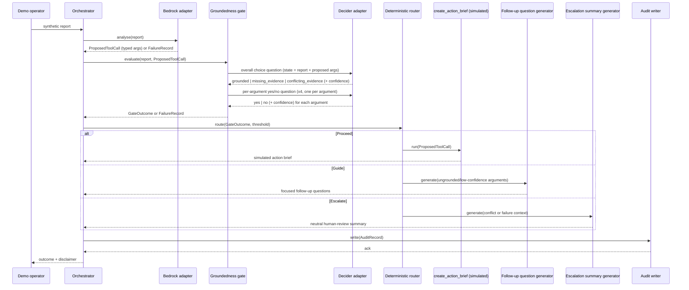

# Design: StrandSentinel — Evidence Groundedness Gate

Status: draft, not yet approved for implementation. This design implements the approved baseline in
[`docs/requirements.md`](requirements.md) and the constraints in [`CLAUDE.md`](../CLAUDE.md). It describes
conceptual components, data shapes, and decision logic only — it does not define or invent concrete SDK
calls. Every point that depends on an unverified SDK/API detail is marked **[VERIFY]**, consistent with the
VERIFY markers already present in the requirements.

---

## 1. Architecture overview

StrandSentinel is a single request/response pipeline, not a long-running service. One synthetic report goes
in; one outcome (Proceed, Guide, or Escalate) and one JSON audit record come out. The pipeline has two model
calls — one generative (Bedrock), one decisive (Strands Decider 2B) — separated by a hard gate: the
simulated tool call cannot execute until the gate has returned a result, and the gate's result, not the
generative model, decides what happens next (Requirement 3.2, 4.4).

The pipeline is intentionally linear and stateless between runs: report → Bedrock proposal → groundedness
gate → deterministic router → one of three output generators → audit write. Nothing upstream of the router
is allowed to short-circuit the router's decision (Requirement 4.4, 7.4).

## 2. Sequence diagram



Failure handling (Requirement 7) is not drawn as a separate branch for clarity, but the "Escalate" arm of
the diagram above covers two distinct cases with different behaviour inside the Escalation-summary
generator:

- A `FailureRecord` from either the Bedrock adapter or the Decider adapter always routes to Escalate
  (Section 6). Because Bedrock may itself be the unavailable component, the Escalation-summary generator
  does **not** call Bedrock in this case — it builds a deterministic local fallback summary directly from
  the `FailureRecord`'s fields, so this design does not depend on Bedrock being available in order to
  produce an Escalate output.
- A conflicting-evidence Escalate (no failure occurred; the gate itself returned `conflicting_evidence`) is
  the only case where the Escalation-summary generator calls Bedrock, to draft a neutral human-review
  summary of the conflict.

Both cases carry their outcome into the audit record, with `failure_reason` populated only for the
failure-triggered case, and `summary_source` identifying which path produced the summary (Section 8).

## 3. Component responsibilities

| Component | Responsibility | Must NOT do |
|---|---|---|
| **Bedrock adapter** | Send the report to Bedrock; parse the response into a `ProposedToolCall`; on error/timeout/unparseable output, return a `FailureRecord` instead of raising past the orchestrator. | Decide groundedness. Call the simulated tool. Invent argument values not present in Bedrock's response. |
| **Decider adapter** | Send the overall choice question and the four per-argument yes/no questions to Strands Decider 2B with the report + proposed arguments as state; parse responses into `GroundednessAnswer`s; on error/timeout/unparseable output, return a `FailureRecord`. | Generate text. Decide the final outcome (that's the router's job). |
| **Groundedness gate** | Own the conversation with the Decider adapter: build the question set from a `ProposedToolCall`, collect all answers, assemble them into a single `GateOutcome`. This is the `#guardrails` pattern itself (Requirement 3.6, 9.1). | Call Bedrock. Call the simulated tool directly. |
| **Deterministic router** | Apply the fixed logic in Section 6 to a `GateOutcome` (or `FailureRecord`) and a configurable confidence threshold; emit exactly one of Proceed / Guide / Escalate; dispatch to the matching generator. | Call any model. Contain any non-deterministic logic — the same `GateOutcome` + threshold must always route the same way. |
| **Simulated `create_action_brief` tool** | On Proceed only: assemble the `ProposedToolCall`'s arguments into a simulated action brief object. | Perform any real-world routing, dispatch, or notification (Requirement 2.2). Run on any outcome other than Proceed (Requirement 4.4). |
| **Follow-up question generator** | On Guide: ask Bedrock to draft follow-up questions scoped only to the ungrounded/low-confidence argument(s). | Re-run the groundedness gate itself. Touch grounded arguments. |
| **Escalation-summary generator** | On Escalate: for conflicting-evidence cases, ask Bedrock to draft a neutral summary of the conflict for human review, without resolving the conflict itself. For Bedrock failure, Decider failure, timeout, or invalid model output, generate a deterministic local fallback summary built only from `FailureRecord` fields — no Bedrock call is made. | Make a determination about which conflicting claim is correct. Omit the disclaimer. Call Bedrock again on a failure-triggered Escalate. |
| **Audit writer** | Serialize one `AuditRecord` (or `FailureRecord`-inclusive `AuditRecord`) to JSON per run, per the schema in Section 8. | Write real personal data (Requirement 6.4). Skip writing on failure runs (Requirement 6.5). |

## 4. Conceptual data models

These are conceptual shapes for design purposes, not concrete class/type definitions — concrete field
encodings depend on the implementation language, which is not yet chosen.

**SyntheticReport**

| Field | Type | Notes |
|---|---|---|
| `report_id` | string | Identifier for the fixture/run. |
| `text` | string | Full synthetic report text, fabricated, no real personal data. |

**ProposedToolCall**

| Field | Type | Notes |
|---|---|---|
| `tool_name` | string | Always `"create_action_brief"` — simulated, never executed outside Proceed. |
| `issue_category` | string \| `"not stated"` | As proposed by Bedrock. |
| `location` | string \| `"not stated"` | As proposed by Bedrock. |
| `onset_or_duration` | string \| `"not stated"` | As proposed by Bedrock. |
| `urgency` | string \| `"not stated"` | As proposed by Bedrock. |
| `raw_model_response` | opaque | **[VERIFY]** Shape depends on the Bedrock response format actually used. |

**GroundednessQuestion**

| Field | Type | Notes |
|---|---|---|
| `question_id` | string | Unique per question within a run. |
| `kind` | `"overall"` \| `"per_argument"` | See Section 5. |
| `argument_name` | string \| null | Null for the overall question. |
| `text` | string | The literal typed question text sent to Decider. |
| `options` | list of string | `["grounded","missing_evidence","conflicting_evidence"]` for overall; `["yes","no"]` per-argument. |
| `state` | object | The report text + the full proposed argument set, passed as Decider's "state" input. |

**GroundednessAnswer**

| Field | Type | Notes |
|---|---|---|
| `question_id` | string | Matches the originating `GroundednessQuestion`. |
| `value` | string | One of the question's declared options. |
| `confidence` | number | Calibrated confidence as returned by Decider. **[VERIFY]** exact scale/semantics. |
| `raw_decider_output` | opaque | **[VERIFY]** Shape depends on the real Decider 2B output schema. |

**GateOutcome**

| Field | Type | Notes |
|---|---|---|
| `overall_answer` | `GroundednessAnswer` | Result of the overall choice question. |
| `per_argument_answers` | list of `GroundednessAnswer` | One per proposed argument (4 entries). |
| `ungrounded_arguments` | list of string | Argument names whose per-argument answer was `"no"`. |
| `lowest_confidence` | number | Minimum confidence across the overall answer and all per-argument answers. |

**AuditRecord** — see full field list in Section 8.

**FailureRecord**

| Field | Type | Notes |
|---|---|---|
| `stage` | `"bedrock"` \| `"decider"` | Which adapter failed. |
| `error_type` | string | e.g. timeout, unavailable, unparseable-output. |
| `error_message` | string | Human-readable detail, no real personal data. |
| `occurred_at` | timestamp | When the failure was observed. |

## 5. Decider decision design

Per Requirement 3, the Evidence Groundedness Gate asks Decider 2B a fixed set of typed questions for every
run, using the report and Bedrock's proposed arguments as state:

1. **One overall choice question**, options exactly:
   - `grounded` — all proposed arguments are explicitly supported and nothing conflicts
   - `missing_evidence` — at least one proposed argument lacks explicit support, with no conflict
   - `conflicting_evidence` — the report contains statements that conflict regarding at least one argument
2. **Four per-argument yes/no questions**, one per `create_action_brief` argument (`issue_category`,
   `location`, `onset_or_duration`, `urgency`), each asking whether that exact proposed argument value is
   explicitly supported by the report text.

State passed to Decider for every question is the same pair: the full report text and the full proposed
argument set (so Decider can judge an individual argument's wording against the whole report, not just an
isolated fragment).

Every Decider answer carries a confidence value, which is recorded on the corresponding `GroundednessAnswer`
(Section 4). A single configurable confidence threshold is compared against `GateOutcome.lowest_confidence`;
falling below it triggers the low-confidence fallback defined in Requirement 4.7 and Section 6. The
threshold's default value and calibration method are not decided here — see VERIFY item in Section 10.

**[VERIFY]** The exact Strands Decider 2B SDK/package name, installation method, call signature, and
request/response schema (including whether "state" and "typed question" map onto real parameter names as
assumed above) must be confirmed against official documentation before any of this is implemented. Nothing
in this section should be read as a working API call.

## 6. Deterministic routing

Routing is pure logic over a `GateOutcome` (or a `FailureRecord`) and the configured threshold — it calls no
model and has no hidden state. Expressed as decision logic (not a specific language's syntax):

```
if a FailureRecord was produced by either adapter:
    outcome = ESCALATE          # Requirement 7.1 / 7.2

elif overall_answer.value == "conflicting_evidence":
    outcome = ESCALATE          # Requirement 4.3, 4.6

elif overall_answer.value == "grounded"
     and every per_argument_answer.value == "yes"
     and ungrounded_arguments is empty
     and lowest_confidence >= threshold:
    outcome = PROCEED           # Requirement 4.1

elif lowest_confidence < threshold:
    # Requirement 4.7: low confidence defaults to Guide,
    # unless the low-confidence answer is itself the conflicting_evidence case (handled above)
    outcome = GUIDE

else:
    # overall_answer.value == "missing_evidence", or any per-argument "no", with no conflict
    outcome = GUIDE             # Requirement 4.2

# Invariant: only PROCEED may execute the simulated tool call (Requirement 4.4, 3.2)
```

This logic is implementation-language-agnostic and is the unit the testability design in Section 7 targets
directly.

The router's ESCALATE result always carries which of the two causes applies — `failure` or
`conflicting_evidence` — because the Escalation-summary generator and audit writer both need to know which
summary path to take: a failure-triggered ESCALATE always uses the deterministic local fallback summary (no
Bedrock call, since Bedrock may be the thing that's down), while a conflicting-evidence ESCALATE is the only
case that calls Bedrock for a neutral summary (Section 3, Section 8).

## 7. Testability

1. **`DeciderClient` adapter boundary.** The Decider adapter is defined behind a small interface (e.g.
   `evaluate(question, state) -> GroundednessAnswer`) so that it can be swapped for a deterministic stub in
   tests. **[VERIFY]** the real implementation of this interface once the Decider SDK is confirmed; the
   interface itself is an internal design choice, not a Decider API.
2. **Stubbed unit tests.** Using a stub `DeciderClient` that returns fixed, hand-authored answers, unit
   tests prove: each of the three required fixtures (Requirement 8) routes to its intended outcome; the
   simulated tool is only ever invoked on Proceed; Guide/Escalate correctly block the tool; the audit record
   is written for every case including failure injection; the disclaimer is present on every output.
3. **Real Decider evaluation (separate from unit tests).** A separate evaluation run (not part of the
   deterministic unit-test suite) invokes the actual Strands Decider 2B against the same fixtures and
   records its real outputs, confidence values, and per-call latency to a report. This evaluation does
   **not** assert a specific expected outcome per fixture — Decider's real behaviour on a given input is an
   observation, not a hard-coded expectation — but it SHOULD flag when a real result disagrees with the
   fixture's intended outcome, so disagreements are visible rather than silently passing.
4. **Fixtures.** The three required synthetic fixtures from Requirement 8 (Proceed, Guide, Escalate) are the
   shared input for both the stubbed unit tests and the real Decider evaluation, so behaviour can be
   compared directly between the deterministic stub and the live model.

## 8. Audit JSON record — fields

Per Requirement 6, one JSON `AuditRecord` is written per run, success or failure:

| Field | Type | Notes |
|---|---|---|
| `run_id` | string | Unique per run. |
| `timestamp` | ISO-8601 string | Start-of-run time. |
| `fixture_id` | string \| null | Which of the required fixtures this run used, if any (null for ad-hoc input). |
| `input_report` | object | `SyntheticReport` as submitted. |
| `bedrock_proposal` | object \| null | `ProposedToolCall` as returned, null if the Bedrock call failed. |
| `decider_questions` | list of object | The `GroundednessQuestion`s actually sent, if the Decider call was reached. |
| `decider_results` | list of object | The `GroundednessAnswer`s received (value + confidence per question). |
| `confidence_threshold` | number | The threshold value in effect for this run. |
| `final_outcome` | `"proceed"` \| `"guide"` \| `"escalate"` | Router's result. |
| `behaviour_taken` | string | What actually happened (e.g. "tool executed", "follow-up questions generated", "escalation summary generated"). |
| `failure_reason` | object \| null | `FailureRecord` if a failure triggered Escalate (Requirement 7.3), else null. |
| `summary_source` | `"bedrock_conflict_summary"` \| `"deterministic_failure_summary"` \| null | Set only when `final_outcome` is `"escalate"`: `"bedrock_conflict_summary"` for a conflicting-evidence Escalate (Bedrock called), `"deterministic_failure_summary"` for a failure-triggered Escalate (no Bedrock call); null for Proceed/Guide. |
| `latency_ms` | object | Per-call latency breakdown, e.g. `{ "bedrock_ms": …, "decider_ms": … }`. |
| `model_identifiers` | object | Bedrock model ID and Decider model identifier, read from configuration — never hard-coded (Section 10 VERIFY). |
| `disclaimer` | string | The mandatory disclaimer text, verbatim (Requirement 5.1). |

Consistent with Requirement 6.4, no field above may contain real personal data — only synthetic fixture
content and system-generated metadata.

## 9. Reusable pattern folder (future contents)

This section describes what will eventually populate `patterns/evidence_groundedness_gate/` under
Requirement 9 — it is a design target, not something created by this document:

```
patterns/evidence_groundedness_gate/
├── README.md              # what the pattern is, when to reuse it, link back to this design
├── questions.md            # the exact typed question/option set from Section 5, as a standalone reference
├── routing_policy.md       # the deterministic routing logic from Section 6, as a standalone reference
├── INTEGRATION.md          # wiring notes: where this gate sits in an agent's tool-call path
│                           #   [VERIFY] once the real Strands tool-interception API is confirmed
└── tests/                  # stubbed routing tests proving the policy against the three fixtures
```

## 10. VERIFY — open items before implementation

- **Decider package/API and output schema.**
  - Confirmed: package/install name `strands-decider`.
  - Confirmed: local CLI and server modes exist.
  - Confirmed: choice, yes/no, and score question types exist.
  - Confirmed: confidence is returned on decisions.
  - **[VERIFY]** exact HTTP `/v1/systemone` request and response field names, exact Python API signatures,
    and exact adapter code.
- **Strands Agents tool-interception API.**
  - Confirmed: `InterventionHandler` with `before_tool_call`.
  - Confirmed: official actions include `Proceed`, `Deny`, `Guide`, `Confirm`, and `Transform`.
  - Confirmed: `Escalate` is not an SDK action; it remains a StrandSentinel application-level result
    implemented by blocking the tool, most likely through `Deny`, subject to exact integration verification.
  - **[VERIFY]** exact installed package version, imports, event fields, and final adapter implementation.
- **Bedrock model ID and structured-output/tool-use API.** **[VERIFY]** Which model ID to configure, and the
  actual mechanism for getting a structured/typed proposal (e.g. tool-use/function-calling response parsing)
  out of Bedrock.
- **Decider deployment/runtime approach.**
  - Confirmed for the prototype: local execution on Apple Silicon is available through the documented MLX,
    MPS, or CPU paths.
  - **[VERIFY]** exact model download/weight setup, hardware performance for this Mac, and any AWS-hosted
    deployment.
- **Model confidence threshold calibration.** **[VERIFY]** No default threshold value or calibration method
  is set by this design; it must be chosen (and justified) once real Decider confidence outputs can be
  observed via the real-Decider evaluation in Section 7. Informational reference only, not a chosen
  production threshold: official docs note that "answers at a confidence of 0.9 or more are right about 95%
  of the time on short classification tasks."
